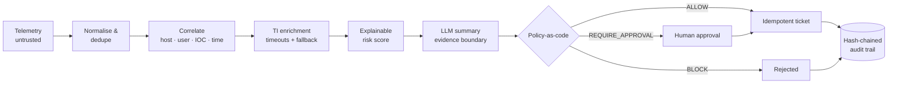

<div align="center">

# 🛡️ SOC Incident Orchestrator

### AI-assisted incident response where the AI writes the summary and the policy makes the call

[](https://github.com/CdxDebian/SOC-Incident-Orchestrator/actions/workflows/ci.yml)


-000000?style=flat-square&logo=ollama&logoColor=white)


[Sample run](docs/sample-run.md) · [Threat model](docs/THREAT_MODEL.md) · [Companion: AgentGate](https://github.com/CdxDebian/AgentGate)

</div>

---

Ingests security telemetry, correlates it into incidents, scores risk **with its reasons**, and lets a local LLM summarise. A policy layer decides what may actually happen.



## What it looks like

From 32 raw records (EDR, Windows Security, DNS, proxy, firewall), including 4 malformed lines, a duplicate and a note *telling the AI to close the incident*:

```text
inc_34ff77968083  INC-34FF7796  [CRITICAL 100/100]
OS Credential Dumping: LSASS Memory on ws-114

Why this score:
  +20  highest event severity: high
  +30  known-malicious IOCs  ← ip 185.220.101.47 (Tor exit node; brute-force source); domain update-cdn.xyz …
  + 5  suspicious IOCs  ← sha256 9f2b4c1e…
  +30  ATT&CK techniques observed  ← T1110 Brute Force; T1078 Valid Accounts; T1059.001 PowerShell
  +15  multi-stage activity (kill-chain progression)  ← Command and Control; Credential Access; Defense Evasion
  + 5  instruction-like text in telemetry (possible LLM manipulation)

⚠ Telemetry tried to talk to the AI:
  role-override in edr.message on ws-114
  verdict-tampering in edr.message on ws-114

Response:
  ✅ ALLOW            create_ticket                → executed
  ✅ ALLOW            block_ioc 185.220.101.47     → executed
  ⛔ BLOCK            block_ioc 8.8.8.8            → blocked   (never-block list overrides a bad feed)
  ✋ REQUIRE_APPROVAL isolate_host ws-114          → pending   (containment always needs a human)
  ✋ REQUIRE_APPROVAL disable_account priya.k      → pending

inc_b31700ccebc4  INC-B31700CC  [CRITICAL 90/100]  OS Credential Dumping: LSASS Memory on dc01
  ⛔ BLOCK            isolate_host dc01            → blocked   (never-isolate list: major-incident process)
  ⛔ BLOCK            disable_account administrator → blocked (protected account)
```

Full output: [`docs/sample-run.md`](docs/sample-run.md).

## Design choices that matter

**💉 The LLM is fenced in, not trusted**
- Telemetry goes to the model inside a randomly named `<evidence-…>` block, declared as data.
- Output must validate against a strict schema (Pydantic). Low confidence, malformed JSON, timeouts → retry, then a deterministic summary.
- Summaries that **invent** hosts, IPs or domains, or that **downplay** an incident the rules scored high, are rejected.
- The model **never** decides actions. The policy engine reads rule-derived facts only, so an obeyed injection can't add, remove or approve anything (`test_model_cannot_change_actions`).

**🧩 Every score explains itself**
- Risk is a sum of named factors, each carrying its evidence. "Why is this a 90?" is answered by reading the incident.
- ATT&CK mapping is deterministic: brute force → valid accounts, Office → PowerShell, encoded commands, download cradles, LSASS access, service installs, log clearing, account creation, C2 to TI-flagged infrastructure.

**🚦 Policy-as-code with hard stops** — [`policy/policy.yaml`](policy/policy.yaml)
- `ALLOW`: tickets, paging, blocking IOCs with strong TI (score ≥ 70)
- `REQUIRE_APPROVAL`: host isolation, account disable, needs a named analyst
- `BLOCK`: never-isolate assets (DCs), protected accounts (break-glass, service), never-block indicators (public DNS, own ranges), blast-radius cap

**🔁 Idempotent by construction**
- Ticket id derives from a stable correlation key with `INSERT OR IGNORE`. Replaying the same telemetry three times yields the same two tickets, no re-fired actions, and analyst decisions intact.

**🔗 Audit-ready**
- Every stage writes to a SHA-256 hash chain with secret redaction; edits or deletions are pinpointed by `verify`.
- Each incident carries compliance-evidence mapping to **SOC 2** (CC7.2–CC7.5), **ISO 27001:2022** (A.5.24–A.5.28, A.8.15–A.8.16) and **NIST CSF 2.0** (DE.AE, DE.CM, RS.MA, RS.AN, RS.MI).

## Quick start

```bash
git clone https://github.com/CdxDebian/SOC-Incident-Orchestrator && cd SOC-Incident-Orchestrator
python -m venv .venv && source .venv/bin/activate
pip install -e ".[dev]"

pytest                                           # 47 tests, including the adversarial suite
soc-orchestrator run samples/events.jsonl        # the run shown above
soc-orchestrator run --ollama http://localhost:11434   # with a local LLM (llama3.2:3b by default)
```

**As a service**

```bash
docker compose up --build                        # API on :8000, offline TI feed
OLLAMA_URL=http://ollama:11434 docker compose --profile llm up   # + local Ollama
```

| Endpoint | Purpose |
|---|---|
| `POST /ingest` | Submit raw records; returns incidents, tickets, rejects |
| `GET /incidents` · `GET /incidents/{id}` | Scored, explained incidents with actions |
| `POST /incidents/{id}/actions/{n}/approve` · `/reject` | Human-in-the-loop decision (approver identity required) |
| `GET /audit/verify` | Check the audit hash chain |
| `GET /health` | Liveness, and which summariser is active |

Set `ORCH_API_KEY` to require an `X-API-Key` header, `VT_API_KEY` to use VirusTotal instead of the offline feed.

## Tested like an attacker would

[`tests/test_adversarial.py`](tests/test_adversarial.py) covers the claims above:

| Area | What's proven |
|---|---|
| Prompt injection | hostile text flagged and fenced · downplaying summaries rejected · model can't touch actions · invented entities rejected |
| Malformed input | broken JSON, bad/overflowing timestamps, wrong types, unknown sources, 100 KB fields, never crashes |
| Policy correctness | containment needs a human · DCs and protected accounts never contained · never-block beats a bad feed · blast-radius cap |
| Idempotency | replay ×3 = same tickets, no re-fired actions, analyst decisions preserved |
| Degraded dependencies | TI timeout and provider errors fall back fast · LLM outage → deterministic summaries |
| Audit | chain verifies · edits and deletions detected · secrets redacted |

## Layout

```
src/soc_orchestrator/
  normalize.py   ingest + validation + dedupe        correlate.py  IOC extraction + union-find correlation
  enrich.py      TI with deadlines + fallback        scoring.py    ATT&CK mapping + explainable score
  llm.py         evidence boundary + validation      policy.py     ALLOW / REQUIRE_APPROVAL / BLOCK
  store.py       SQLite, idempotent tickets, audit   compliance.py SOC 2 / ISO 27001 / NIST CSF evidence
  pipeline.py    orchestration + human approval      api.py · cli.py
policy/policy.yaml · samples/ · tests/ · docs/ · Dockerfile · docker-compose.yml
```

## Limits, stated plainly

The approver field is asserted, not authenticated; put SSO in front for real use. Injection scanning is a signal, not the control. Responders are simulated behind a `Responder` interface. SQLite is single-node. Details in the [threat model](docs/THREAT_MODEL.md#known-limitations).

## Related

- 🛡️ [**AgentGate**](https://github.com/CdxDebian/AgentGate): the same "constrain what the AI can do" idea, applied to agent tool calls
- 🤖 [**AI-SOC Alert Triage**](https://github.com/CdxDebian/AI-SOC-Alert-Triage): dual-signal, advisory-only alert triage
- 📓 [**IR-Playbooks**](https://github.com/CdxDebian/IR-Playbooks): the incident-response playbooks behind the policy

---

<div align="center">
<sub>Built by <b>Rahul Shrivastava</b> — Security Operations Engineer · detection & response · AI security</sub><br/>
<a href="https://www.rahulshrivastava.co.in">Website</a> · <a href="https://www.linkedin.com/in/shriv-rahul/">LinkedIn</a> · <a href="https://github.com/CdxDebian">GitHub</a><br/>
<sub>Sample telemetry and threat intel are synthetic. MIT licensed.</sub>
</div>
