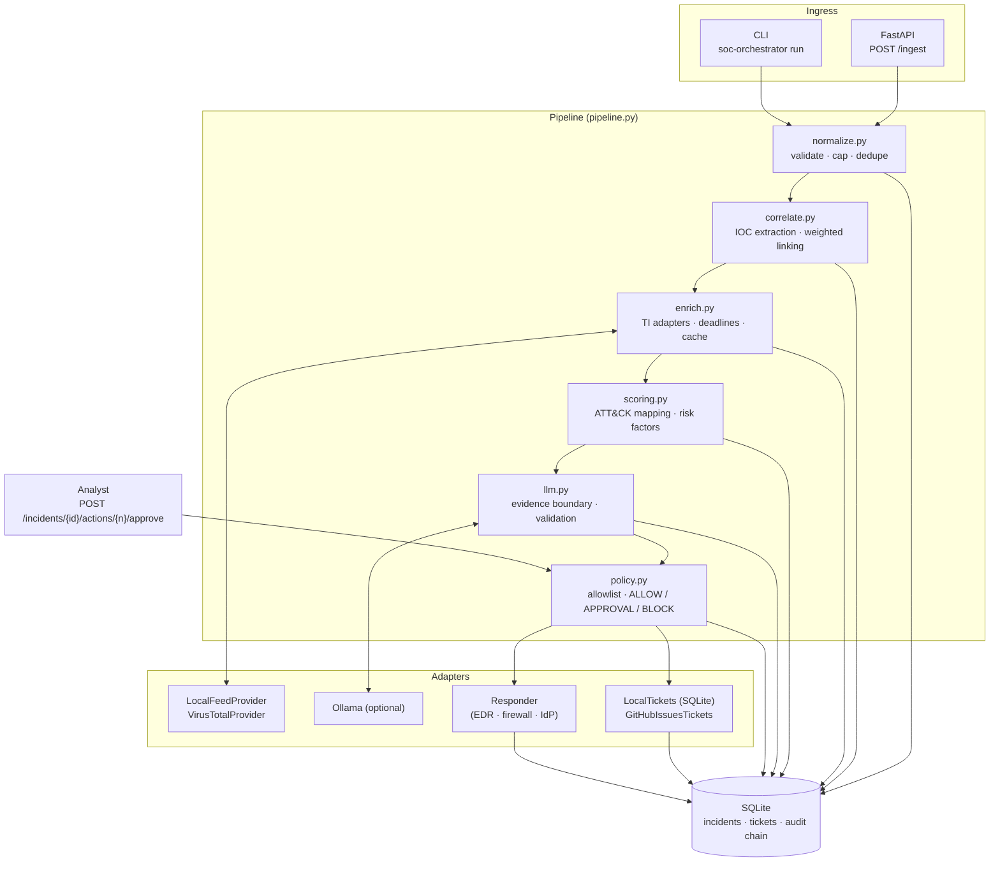

# Architecture — SOC Incident Orchestrator

## Components

| Module | Responsibility | Key decisions |
|---|---|---|
| `normalize.py` | Map Windows Security, EDR, DNS, proxy and firewall records to one `Event` schema | Bad records are rejected with a reason, never raised; fields capped at 4 KB; SHA-256 fingerprint dedupe |
| `correlate.py` | Extract IOCs; group events into incidents | IOCs: IPv4 (public only), domain (real TLDs only), URL, email, MD5/SHA1/SHA256, with refanging. Linking: **weighted scoring** (below) |
| `enrich.py` | Threat-intel lookups behind a `TIProvider` adapter | Per-lookup deadline; errors and timeouts degrade to `unknown` with a note; results cached |
| `scoring.py` | Deterministic ATT&CK mapping and risk score | Score = sum of named factors, each with evidence; the LLM never touches it |
| `llm.py` | Analyst-facing summary | Telemetry fenced in a random `<evidence-…>` tag; schema-validated output; grounded-or-rejected; deterministic fallback |
| `policy.py` | Decide every response action | Reads rule-derived facts only; explicit action allowlist; hard BLOCK lists; blast-radius cap |
| `tickets.py` | Idempotent ticketing | Keyed on the correlation key; SQLite or GitHub Issues |
| `store.py` | Persistence and audit | SQLite; SHA-256 hash chain over every audit record; secrets redacted before write |
| `compliance.py` | Evidence mapping | SOC 2 CC7.x, ISO 27001:2022 A.5.24–A.5.28 / A.8.15–A.8.16, NIST CSF 2.0 DE/RS |

## Weighted correlation

Two events are linked when the weighted evidence that they belong together reaches **0.5**:

| Shared signal | Weight | Why |
|---|---:|---|
| External IOC (IP, domain, URL, email, hash) | 0.6 | Strongest evidence: attacker infrastructure rarely coincides by chance |
| Host | 0.5 | Enough on its own only when the events are close in time |
| User | 0.3 | Never enough alone: service and admin accounts log on everywhere |
| Time gap > half the window | ×0.75 | Evidence weakens with distance |
| Time gap > window (2 h) | 0 | Never linked |

Linking is transitive (union-find over the links), so brute force → logon → macro → PowerShell → C2 → LSASS access on one host becomes a single incident, while unrelated hosts that merely share a service account stay apart. `link_score()` returns the signals behind every link.

## Data flow for one incident

1. **Ingest:** 32 raw records → 27 valid events, 4 rejected with reasons, 1 duplicate dropped.
2. **Correlate:** weighted links → 3 clusters.
3. **Enrich:** IOCs looked up through the TI adapter, with deadlines.
4. **Score:** ATT&CK techniques and risk factors → 100, 90 and 5 (the last is suppressed as noise).
5. **Summarise:** the LLM, if configured, inside the evidence boundary; otherwise the deterministic summary.
6. **Decide:** the policy turns facts into actions. The allowlist is applied last, so it always wins.
7. **Execute:** ALLOW actions run once; REQUIRE_APPROVAL waits for a named analyst; BLOCK is recorded and refused.
8. **Ticket:** upserted by correlation key. Replays update the ticket and never duplicate it.
9. **Audit:** every step is chained; `GET /audit/verify` checks the whole chain.

## Idempotency guarantees

| Scenario | Behaviour |
|---|---|
| Same batch replayed | Same incident ids and ticket ids; executed actions are not re-run; analyst decisions are preserved |
| GitHub backend, same process | Mapping cached in SQLite: no API calls on replay |
| GitHub backend, database lost | Existing issue found by its `orch:<key>` label and relinked, not recreated |

## Deployment

- **Docker:** non-root user, health check. The compose file adds a read-only root filesystem, `cap_drop: ALL`, `no-new-privileges`, and an optional Ollama service.
- **Configuration** (environment): `DB_PATH`, `POLICY`, `ORCH_API_KEY`, `OLLAMA_URL`, `OLLAMA_MODEL`, `VT_API_KEY`, `TI_FEED`, `GITHUB_REPO`, `GITHUB_TOKEN`.
- **Scaling:** single node with SQLite. Swap `Store` for Postgres, and run enrichment through a queue, for multi-node.

See also the [threat model](THREAT_MODEL.md).
